# Thời gian boot BeagleBone Black: đến UI infotainment

## Baseline: cấu hình mặc định
Chưa tối ưu, **trung bình 3 lần đo**. Log: `baseline-run01..03.grabserial.log`, `baseline-run01..03.board.log`. Mốc 0 = dòng `U-Boot SPL` trên serial (chưa tính ROM code).

### Tổng quan: bật nguồn đến UI mất bao lâu?
**Khoảng 26,5 giây** từ SPL đến khi UI chính hiện xong (T2).

| Giai đoạn | Thời gian | Tỷ lệ |
|---|---|---|
| 1. Bootloader (SPL, U-Boot) | 4,16 s | 16% |
| 2. Giải nén (`Starting kernel` → dòng kernel đầu) | 4,44 s | 17% |
| 3. Kernel (đến `Run /sbin/init`) | 4,99 s | 19% |
| 4. Userspace (init → first-frame) | 12,93 s | 49% |
| **Tổng đến T2** | **≈ 26,5 s** | |

- **T1** (hình đầu tiên, `fbcon` lên HDMI): ≈ 13,2 s (chỉ là chữ console của kernel, chưa phải GUI).
- **T2** (UI chính xong): ≈ 26,5 s, dao động 26,36 đến 26,60 s.
- Chưa tính ROM code chạy trước SPL, vì nó không in gì ra serial.

### Sơ đồ chuỗi boot
Màu đỏ: hai khoản lớn nhất.

```mermaid
%%{init: {
  'theme': 'base',
  'themeVariables': {
    'fontFamily': '-apple-system, BlinkMacSystemFont, Segoe UI, Roboto, monospace',
    'fontSize': '12px',
    'titleColor': '#0969da',
    'gridColor': '#d0d7de',
    'lineColor': '#0969da',
    'sectionBkgColor': '#f6f8fa',
    'altSectionBkgColor': '#ffffff',
    'sectionBkgColor2': '#f6f8fa',
    'doneTaskBkgColor': '#2da44e',
    'doneTaskBorderColor': '#1a7f37',
    'doneTaskTextColor': '#ffffff',
    'critBkgColor': '#cf222e',
    'critBorderColor': '#a40e26',
    'critTextColor': '#ffffff',
    'activeTaskBkgColor': '#0969da',
    'activeTaskBorderColor': '#0550ae',
    'activeTaskTextColor': '#ffffff',
    'milestoneBkgColor': '#d4a72c',
    'milestoneBorderColor': '#9a6700'
  }
}}%%
gantt
    title Boot Chain Baseline (0.00s ➔ 26.52s)
    dateFormat x
    axisFormat %S s
    tickInterval 2second

    section 1. Bootloader (4.16s)
    SPL nạp U-Boot [0.00s → 0.78s] (0.78s)            :done, a1, 0, 778
    U-Boot init [0.78s → 1.45s] (0.67s)               :done, a2, 778, 1446
    Autoboot delay [1.45s → 3.52s] (2.08s)            :crit, a3, 1446, 3522
    Read extlinux, DTB, kernel [3.52s → 4.16s] (0.64s):done, a4, 3522, 4158

    section 2. Decompress (4.44s)
    zImage decompress [4.16s → 8.60s] (4.44s)         :crit, a5, 4158, 8600

    section 3. Kernel (4.99s)
    Kernel to /sbin/init [8.60s → 13.59s] (4.99s)     :active, a6, 8600, 13590
    T1 fbcon ready @ 13.19s                           :milestone, 13190, 13190

    section 4. Userspace (12.93s)
    Init to first-frame [13.59s → 26.52s] (12.93s)    :active, a7, 13590, 26520
    T2 first-frame @ 26.52s                           :milestone, 26520, 26520
```



### Mốc trên log
Dòng kernel/journal: `t_SPL` = timestamp kernel `[ x ]` + 8,60.

| t_SPL (s) | Dòng log | Nguồn | Δ (s) | Ý nghĩa |
|---|---|---|---|---|
| 0,00 | `U-Boot SPL 2025.10-ti-...` | serial | | SPL bắt đầu |
| 0,78 | `U-Boot 2025.10-ti-...` | serial | 0,78 | SPL nạp xong U-Boot |
| 1,45 | `Hit any key to stop autoboot:  2` | serial | 0,67 | U-Boot khởi tạo xong (riêng `MMC:` ≈ 0,40) |
| 3,52 | `switch to partitions #0, OK` | serial | 2,08 | hết đếm ngược autoboot |
| 4,16 | `Starting kernel ...` | serial | 0,64 | đọc xong extlinux, zImage (≈ 0,55), DTB |
| 8,60 | `[    0.000000] Booting Linux on physical CPU 0x0` | serial | 4,44 | dòng kernel đầu tiên |
| 13,19 | `[    4.59] Console: switching to colour frame buffer device 160x64` | serial | 4,59 | **T1**: fbcon lên HDMI |
| 13,59 | `[    4.99] Run /sbin/init as init process` | serial | 0,40 | kernel giao cho init |
| 25,67 | `[   17.07] systemd[1]: Started MotoCluster LVGL ...` | journal | 12,08 | systemd start app |
| 26,52 | `[   17.92] motocluster-lvgl: [PHASE] first-frame ...` | journal | 0,85 | **T2**: UI vẽ xong |
| 31,21 | `beaglebone login:` | serial | 4,69 | dấu nhắc đăng nhập (ngoài mục tiêu) |

### Chi tiết từng giai đoạn

#### Trước kernel: 8,60 s (đo trực tiếp bằng `grabserial`)
| Bước | Thời gian |
|---|---|
| SPL nạp U-Boot | 0,78 s |
| U-Boot khởi tạo | 0,67 s |
| Đếm ngược autoboot (chờ thuần túy) | 2,08 s |
| Đọc `extlinux.conf`, `zImage`, DTB | 0,64 s |
| `Starting kernel` đến dòng kernel đầu tiên (không in gì) | 4,44 s |

#### Kernel: 5,33 s
| Mốc (thời gian kernel) | |
|---|---|
| `fbcon` lên HDMI | 4,6 s |
| Mount root xong | 5,2 s |
| Giao cho init | 5,3 s |

Có một khoảng trống 1,6 đến 1,8 s không có log, chưa rõ nguyên nhân (xem 5.7).

#### Userspace: 12,59 s (từ lúc kernel giao cho init đến first-frame)
Mốc chính của systemd (tính từ lúc systemd bắt đầu, trung bình 3 lần):

| Mốc | Thời điểm |
|---|---|
| `local-fs.target` xong | 6,0 s |
| `systemd-resolved` bắt đầu (mất 3,6 s) | 7,2 s |
| `basic.target` | 11,0 s |
| `systemd-logind` bắt đầu (mất 1,65 s) | 12,4 s |
| `multi-user.target` | 14,4 s |

App LVGL: systemd ghi `Started` ở kernel 17,07 s, app thật sự chạy sau đó ~0,57 s, và first-frame ở
kernel 17,92 s (app tự đo 274 ms sau khi chạy).

### Bên trong app
| Chỉ số | Lần 1 | Lần 2 | Lần 3 | Trung bình |
|---|---|---|---|---|
| `Started` (journal, kernel s) | 17,142 | 16,997 | 17,069 | 17,07 |
| `lv-init` (ms sau exec) | 33 | 36 | 23 | 31 |
| `ui-built` (ms) | 98 | 97 | 84 | 93 |
| `first-frame` (ms) | 293 | 296 | 234 | 274 |
| Từ `Started` đến exec, s (suy ra) | 0,55 | 0,71 | 0,45 | 0,57 |

### Bên trong systemd (`critical-chain`, mốc từ lúc systemd bắt đầu, trung bình 3 lần)
| Unit | Bắt đầu @ (s) | Mất (s) |
|---|---|---|
| `--.slice` / `--.mount` | 1,66 | |
| `systemd-journald.socket` | 2,01 | |
| `tmpfiles-setup-dev-early` | 3,30 | 1,06 |
| `tmpfiles-setup-dev` | 4,90 | 0,60 |
| `var-volatile.mount` | 5,57 | 0,31 |
| `local-fs.target` | 6,03 | |
| `tmpfiles-setup` | 6,14 | 0,95 |
| `systemd-resolved` | 7,20 | **3,63** |
| `sysinit.target` | 10,88 | |
| `basic.target` | 10,95 | |
| `systemd-logind` | 12,40 | 1,65 |
| `multi-user.target` | 14,38 | |

Ghi chú: `systemd-resolved` ổn định 3,59 đến 3,67 s qua 3 lần. Ở các boot trước (lần đầu tiên) chuỗi còn có
`systemd-sysusers` (+1,53 s) và `resolved` mất 2,84 s; chưa rõ vì sao chuỗi khác đi. Phụ thuộc của app
(`systemctl show motocluster-lvgl -p After`): `local-fs.target`, `systemd-journald.socket`, `basic.target`,
`sysinit.target`. Chỉ `local-fs.target` do file `.service` khai báo; phần còn lại do `DefaultDependencies=yes` thêm ngầm.

### systemd `blame` (từ lần boot đầu, không phải đường găng)
| Unit | Thời gian |
|---|---|
| `dev-mmcblk0p2.device` | 13,6 s (thời gian chờ udev, không chặn gì) |
| `systemd-udev-trigger.service` | 6,5 s |
| `systemd-resolved.service` | 2,8 s |
| `systemd-timesyncd.service` | 2,5 s |
| `systemd-logind.service` | 1,96 s |
| `systemd-networkd.service` | 1,88 s |

Nhiều unit rất đơn giản (mount, modprobe) cũng mất 1,5 đến 1,7 s; nghi do tranh một lõi CPU (chưa kiểm chứng).

## Tối ưu 1: app chạy ngay khi systemd sẵn sàng
Cấu hình rootfs (unit systemd), **1 lần đo**. Log: `opt1-run01.grabserial.log`. Chỉ đổi file unit của app, phần còn lại giữ nguyên như baseline.

### Quan sát
Ở baseline, systemd đã chạy từ sớm (`Run /sbin/init` @ 13,59 s) nhưng app đến 25,67 s mới được `Started`,
tức là **chờ ≈ 12 s** dù app chỉ cần `/dev/fb0` (kernel tạo sẵn @ 13,19 s) và rootfs.
`systemd-analyze critical-chain` cho thấy app đứng sau `basic.target`, mà `basic.target` lại đứng sau
`sysinit.target` và `systemd-resolved` (≈ 3,6 s).

### Nguyên nhân
- File unit chỉ khai báo `After=local-fs.target`, nhưng `systemctl show motocluster-lvgl -p After` còn có
  `sysinit.target`, `basic.target`, `systemd-journald.socket`.
- Phần thêm ngầm đến từ `DefaultDependencies=yes` (mặc định của mọi service, xem `man systemd.service`):
  systemd tự gắn `After=sysinit.target basic.target` để service thường chỉ chạy khi hệ thống đã khởi tạo xong.
- App không dùng mạng, DNS, DBus, udev; nó không cần chờ những thứ đó.

### Thay đổi
Đổi đúng hai dòng trong `motocluster-lvgl.service`:

```diff
 [Unit]
 Description=MotoCluster LVGL (fixed UI for boot time study)
-After=local-fs.target
+DefaultDependencies=no
+RequiresMountsFor=/usr/bin
```

- `DefaultDependencies=no`: bỏ các ràng buộc ngầm, app không còn chờ `basic.target`.
- `RequiresMountsFor=/usr/bin`: chỉ chờ đúng mount chứa binary của app.
- `/dev/fb0` được đảm bảo bởi thứ tự boot (driver built-in, có trước init), không phải bởi unit.

### Kết quả
| Giai đoạn | Baseline | Tối ưu 1 | Chênh |
|---|---|---|---|
| 1. Bootloader | 4,16 s | 4,15 s | 0 |
| 2. Giải nén | 4,44 s | 4,44 s | 0 |
| 3. Kernel | 4,99 s | 5,05 s | +0,06 (nhiễu, kernel không đổi) |
| 4. Userspace (init → first-frame) | 12,93 s | ≈ 3,44 s | **−9,5** |
| T1 (fbcon) | 13,19 s | 13,19 s | 0 |
| **T2** | **26,52 s** | **≈ 17,08 s** | **−9,4 s (−35%)** |

```mermaid
%%{init: {
  'theme': 'base',
  'themeVariables': {
    'fontFamily': '-apple-system, BlinkMacSystemFont, Segoe UI, Roboto, monospace',
    'fontSize': '12px',
    'titleColor': '#0969da',
    'gridColor': '#d0d7de',
    'lineColor': '#0969da',
    'sectionBkgColor': '#f6f8fa',
    'altSectionBkgColor': '#ffffff',
    'sectionBkgColor2': '#f6f8fa',
    'doneTaskBkgColor': '#2da44e',
    'doneTaskBorderColor': '#1a7f37',
    'doneTaskTextColor': '#ffffff',
    'critBkgColor': '#cf222e',
    'critBorderColor': '#a40e26',
    'critTextColor': '#ffffff',
    'activeTaskBkgColor': '#0969da',
    'activeTaskBorderColor': '#0550ae',
    'activeTaskTextColor': '#ffffff',
    'milestoneBkgColor': '#d4a72c',
    'milestoneBorderColor': '#9a6700'
  }
}}%%
gantt
    title Boot Chain Optimization 1 (0.00s ➔ 17.08s)
    dateFormat x
    axisFormat %S s
    tickInterval 2second

    section 1. Bootloader (4.15s)
    SPL nạp U-Boot [0.00s → 0.78s] (0.78s)            :done, b1, 0, 775
    U-Boot init [0.78s → 1.44s] (0.67s)               :done, b2, 775, 1443
    Autoboot delay [1.44s → 3.52s] (2.08s)            :crit, b3, 1443, 3519
    Read extlinux, DTB, kernel [3.52s → 4.15s] (0.63s):done, b4, 3519, 4153

    section 2. Decompress (4.44s)
    zImage decompress [4.15s → 8.60s] (4.44s)         :crit, b5, 4153, 8596

    section 3. Kernel (5.05s)
    Kernel to /sbin/init [8.60s → 13.64s] (5.05s)     :active, b6, 8596, 13644
    T1 fbcon ready @ 13.19s                           :milestone, 13191, 13191

    section 4. Userspace (3.44s)
    Init to first-frame [13.64s → 17.08s] (3.44s)     :active, b7, 13644, 17080
    T2 first-frame @ 17.08s                           :milestone, 17080, 17080
```



## Tối ưu 2: cắt kernel config và tắt bootdelay
Cấu hình kernel và U-Boot. Hai bước nhỏ, mỗi bước đổi đúng một thứ, đo riêng.

### Tối ưu 2a: tắt driver phần cứng không có trên BBB
**1 lần đo.** Log: `opt2a-run01.grabserial.log`; dữ liệu initcall: `diag-initcall01.initcall.log`.

**Quan sát.** `initcall_debug` (`diag-initcall01.initcall.log`) cho thấy kernel bb.org là config đa board: khởi tạo cả
driver cho SoC và PMIC khác. Mọi thứ built-in (`=y`) đều chạy initcall lúc boot, kể cả khi không có thiết bị.

**Cách chọn "chắc chắn không dùng".** Đối chiếu với device tree BBB dùng (`am335x-boneblack*.dts*`,
`am33xx*.dtsi`, `am335x-bone-common.dtsi`): driver không có node nào thì không bao giờ probe.
Không cắt theo tên: `INPUT_TPS65218_PWRBUTTON` mang tên TPS65218 nhưng phục vụ cả nút nguồn TPS65217 của BBB, giữ.

**Thay đổi.** Fragment `disable-non-bbb-hw.cfg` (15 option), nạp qua `KERNEL_CONFIG_FRAGMENTS` trong
`linux-bb.org_%.bbappend` (recipe meta-ti không tự trộn `.cfg` từ `SRC_URI` như `linux-yocto`):

| Nhóm | Option tắt |
|---|---|
| SoC khác | `SOC_OMAP5`, `SOC_DRA7XX` |
| PMIC khác | `MFD/REGULATOR_PALMAS`, `_TPS65218`, `_TPS65219`, `MFD_TPS6594(_I2C/_SPI)`, `REGULATOR_TPS6594` |
| Khối chỉ có trên OMAP4/5/DRA7 | `MFD_OMAP_USB_HOST`, `REGULATOR_TI_ABB`, `REGULATOR_PBIAS` |

**Kết quả** (so với Tối ưu 1):

| Chỉ số | Tối ưu 1 | Tối ưu 2a | Chênh |
|---|---|---|---|
| Kích thước zImage | 8 466 944 B | 8 389 120 B | −76 KiB (−0,9%) |
| 2. Giải nén | 4,44 s | 4,39 s | −0,06 |
| 3. Kernel | 5,05 s | 4,97 s | −0,08 |
| T1 (fbcon) | 13,19 s | 13,11 s | −0,08 |
| **T2** | ≈ 17,08 s | **≈ 16,96 s** | −0,12 (dưới ngưỡng nhiễu 0,25 s) |

Khối Giải nén giảm gần đúng tỷ lệ với kích thước zImage: dấu hiệu đầu tiên ủng hộ giả thuyết
4,4 s là thời gian giải nén.

### Tối ưu 2b: tắt đếm ngược autoboot của U-Boot
**1 lần đo.** Log: `opt2b-run01.grabserial.log`.

**Quan sát.** `Hit any key to stop autoboot: 2` → `switch to partitions` mất 2,08 s, lần nào cũng như nhau:
chờ thuần túy.

**Nguyên nhân.** U-Boot không đọc được `uboot.env` nên dùng env mặc định, trong đó `bootdelay` lấy từ
`CONFIG_BOOTDELAY=2` lúc build.

**Thay đổi.** Fragment `bootdelay.cfg` (`CONFIG_BOOTDELAY=0`) trong `u-boot-bb.org_%.bbappend`; với U-Boot,
`u-boot-configure.inc` của poky tự trộn mọi `.cfg` trong `SRC_URI`. Giá trị `0` vẫn kiểm tra phím một lần,
giữ được đường vào prompt khi cần debug.

**Kết quả** (so với Tối ưu 2a):

| Chỉ số | Tối ưu 2a | Tối ưu 2b | Chênh |
|---|---|---|---|
| Autoboot | 2,08 s | 0,07 s | −2,01 |
| 1. Bootloader | 4,15 s | 2,13 s | −2,02 |
| T1 (fbcon) | 13,11 s | 11,09 s | −2,02 |
| **T2** | ≈ 16,96 s | **≈ 14,95 s** | **−2,01** |

### Tổng kết Tối ưu 2
| Giai đoạn | Baseline | Tối ưu 1 | Tối ưu 2 (2a + 2b) |
|---|---|---|---|
| 1. Bootloader | 4,16 s | 4,15 s | 2,13 s |
| 2. Giải nén | 4,44 s | 4,44 s | 4,39 s |
| 3. Kernel | 4,99 s | 5,05 s | 4,92 s |
| 4. Userspace (init → first-frame) | 12,93 s | ≈ 3,44 s | ≈ 3,52 s |
| T1 (fbcon) | 13,19 s | 13,19 s | 11,09 s |
| **T2** | **26,52 s** | **≈ 17,08 s** | **≈ 14,95 s (−11,6 s, −44% so với baseline)** |

```mermaid
%%{init: {
  'theme': 'base',
  'themeVariables': {
    'fontFamily': '-apple-system, BlinkMacSystemFont, Segoe UI, Roboto, monospace',
    'fontSize': '12px',
    'titleColor': '#0969da',
    'gridColor': '#d0d7de',
    'lineColor': '#0969da',
    'sectionBkgColor': '#f6f8fa',
    'altSectionBkgColor': '#ffffff',
    'sectionBkgColor2': '#f6f8fa',
    'doneTaskBkgColor': '#2da44e',
    'doneTaskBorderColor': '#1a7f37',
    'doneTaskTextColor': '#ffffff',
    'critBkgColor': '#cf222e',
    'critBorderColor': '#a40e26',
    'critTextColor': '#ffffff',
    'activeTaskBkgColor': '#0969da',
    'activeTaskBorderColor': '#0550ae',
    'activeTaskTextColor': '#ffffff',
    'milestoneBkgColor': '#d4a72c',
    'milestoneBorderColor': '#9a6700'
  }
}}%%
gantt
    title Boot Chain Optimization 2 (0.00s ➔ 14.95s)
    dateFormat x
    axisFormat %S s
    tickInterval 2second

    section 1. Bootloader (2.13s)
    SPL nạp U-Boot [0.00s → 0.77s] (0.77s)            :done, c1, 0, 773
    U-Boot init [0.77s → 1.44s] (0.67s)               :done, c2, 773, 1440
    Autoboot delay [1.44s → 1.51s] (0.07s)            :done, c3, 1440, 1510
    Read extlinux, DTB, kernel [1.51s → 2.13s] (0.62s):done, c4, 1510, 2131

    section 2. Decompress (4.39s)
    zImage decompress [2.13s → 6.52s] (4.39s)         :crit, c5, 2131, 6517

    section 3. Kernel (4.92s)
    Kernel to /sbin/init [6.52s → 11.44s] (4.92s)     :active, c6, 6517, 11437
    T1 fbcon ready @ 11.09s                           :milestone, 11094, 11094

    section 4. Userspace (3.52s)
    Init to first-frame [11.44s → 14.95s] (3.52s)     :active, c7, 11437, 14955
    T2 first-frame @ 14.95s                           :milestone, 14955, 14955
```



Phân bổ T2 hiện tại: Giải nén 29%, Kernel 33% (trong đó khoảng trống ≈ 1,64 s chưa rõ), Userspace 24%,
Bootloader 14%. Mỗi bước mới 1 lần đo sạch.
